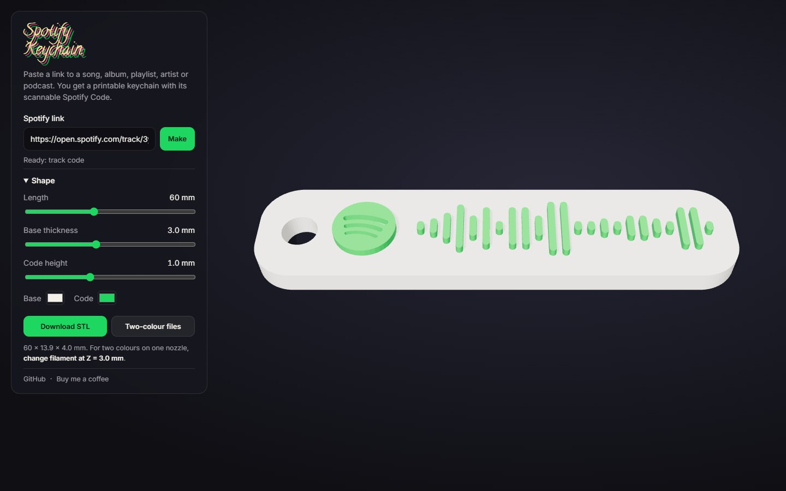

# SpotifySTL

[](https://github.com/amoham42/spotifySTL/actions/workflows/test.yml)
[](LICENSE)
[](https://amoham42.github.io/spotifySTL/)

Turn any Spotify song, album, playlist, artist or podcast into a **3D-printable keychain** carrying its scannable Spotify Code. Everything runs in the browser.

**[Try it →](https://amoham42.github.io/spotifySTL/)**



## Use it

1. In Spotify, choose **Share → Copy link**, paste the link into the box, and press **Make**.
2. Adjust the length, base thickness and code height. The preview updates live.
3. Choose **Download STL** for one file, or **Two-colour files** for the base and the code as separate bodies (for multi-material printers).
4. To print two colours on a single-nozzle printer, add a filament change at the height shown under the buttons, which is the base thickness (3 mm by default).

Point the Spotify app's camera (Search → camera icon) at the printed code and it opens your song.

A keychain can be shared by URL. The page keeps the Spotify URI in its address, as in `…/spotifySTL/#spotify:track:…`.

## How it works

- **The code.** Spotify serves every code as an SVG from its public scannables endpoint: one rounded rectangle per bar, plus the logo. The page fetches that SVG and keeps the dark shapes, recognised by their fill colour rather than their position in the file. It maps them from SVG units (y down) to millimetres (y up) and extrudes them with three.js.
- **The base.** A rounded slab with a key-ring hole, generated to fit the code with an even margin. Its size follows your settings.
- **Print-ready geometry.** The model is built in millimetres with Z up, the way slicers expect. The code sinks 0.05 mm into the base so the two bodies fuse cleanly. Shapes are rebuilt point by point instead of mirrored with a negative scale, which would turn the STL inside out.
- **Links.** `spotify.js` accepts `open.spotify.com` links, including `?si=` tracking, `/intl-xx/` locales and `/embed/` paths, as well as `spotify:` URIs. It is covered by unit tests.

No build step. `index.html`, `main.css`, `keychain.js` and `spotify.js` are the whole app, and three.js loads from a CDN through an import map.

## Develop

```sh
npm start     # serves the folder on http://localhost:8080
npm test      # link-parsing unit tests (Node 20+)
```

## License

[MIT](LICENSE). Spotify and Spotify Codes are trademarks of Spotify AB; this project is not affiliated with Spotify.
